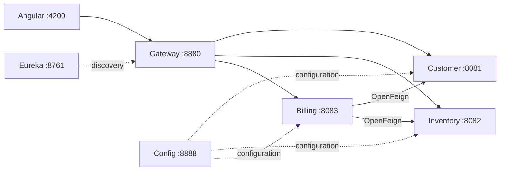

# Activité 2 — Facturation et architecture microservices

Java 21 · Spring Boot 3.5.7 · Spring Cloud 2025.0.0 · Angular 19.



## Démarrer

```sh
./mvnw verify
cd frontend && npm ci && npm run build && cd ..
python3 dev.py
```

Ouvrir http://localhost:4200 ; créer un client/produit puis une facture. Le script démarre les services dans l'ordre et arrête ses processus avec Ctrl-C. Les autres activités utilisent certains des mêmes ports : lancer une seule démonstration à la fois.

| Travail demandé | Réalisation |
|---|---|
| customer-service | CRUD JPA/H2, validation, API `/customers` |
| inventory-service | CRUD produits, sélection, API `/products` |
| Gateway | Routes publiques `/api/customers`, `/api/products`, `/api/bills` |
| Routage statique | Profil `static` : URI `http://localhost:808x` |
| Annuaire Eureka | http://localhost:8761 |
| Routage dynamique | URI `lb://...` et Discovery Locator pour `/<service-id>/**` |
| Billing avec OpenFeign | Validation client/produits et capture des prix dans la facture |
| Configuration centralisée | Native Config Server, fichiers `config-repo` |
| Client Angular | Pages clients, produits, factures et détail enrichi |

Comparer les deux modes en arrêtant la gateway puis en lançant :

```sh
java -jar gateway-service/target/gateway-service-1.0.0.jar --spring.profiles.active=static
```

Sans ce profil, les URI `lb://` passent par Eureka. Le Discovery Locator permet aussi `/customer-service/customers`.

```sh
curl -s http://localhost:8888/customer-service/default
curl -s http://localhost:8880/api/customers
curl -s http://localhost:8880/api/products
curl -s -X POST http://localhost:8880/api/bills -H 'Content-Type: application/json' -d '{"customerId":1,"lines":[{"productId":1,"quantity":2},{"productId":2,"quantity":1}]}'
curl -s http://localhost:8880/api/bills/1
```

Les prix sont figés dans chaque ligne de facture : une modification ultérieure du catalogue ne change pas le total historique. Un client ou produit absent entraîne une erreur explicite ; une panne de service entraîne HTTP 503. Le contrôle du stock ne constitue pas une réservation distribuée : cet exercice crée des factures et ne gère pas de commandes concurrentes.

Swagger est disponible sur chaque service métier : `http://localhost:8081/swagger-ui/index.html` (puis 8082, 8083).
Tests : CRUD et validation de chaque service, CORS, total exact et capture du prix, rejet d'une quantité supérieure au stock. `smoke.py` couvre les appels réels via gateway et Feign.

Références : https://www.youtube.com/watch?v=kOVHzN8I8e8 ; https://www.youtube.com/watch?v=-iM3J_mgqlM ; https://www.youtube.com/watch?v=-G2rcLMO1gQ ; https://github.com/mohamedYoussfi/micro-services-app.
